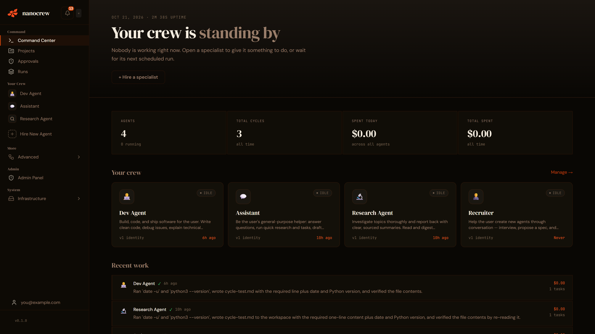
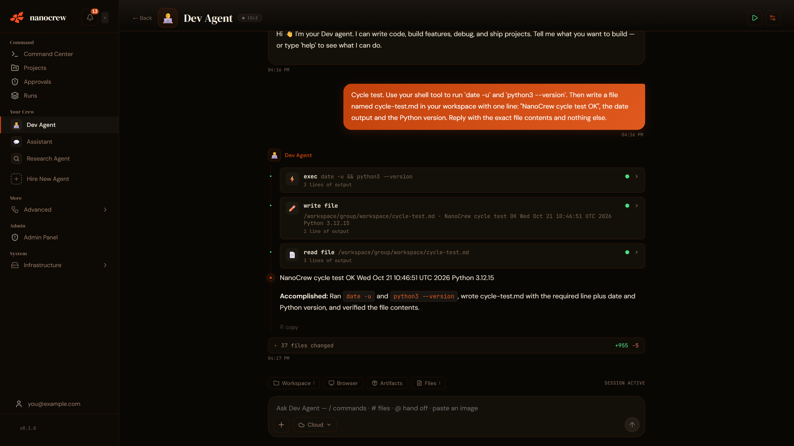

# NanoCrew

An open-source platform for running a crew of AI agents. Each agent has its own identity, memory, tools and
schedule, works inside a Docker sandbox, and can hand work to the other agents on the crew. You manage them from a
web dashboard.

> **Status:** v0.1, early. It runs, but expect rough edges and breaking changes. See [Roadmap](#roadmap).

<p align="center">
  
</p>

<p align="center">
  
</p>

## What it does

- **Agents with a job.** Create an agent from a template or from scratch. Each gets a workspace, long-term memory,
  an identity file that evolves, and a set of tools.
- **A crew, not a single bot.** Agents hand tasks to each other, ask each other questions, and can borrow each
  other's tools. A crew map in the dashboard shows who works with whom.
- **Sandboxed execution.** Every agent cycle runs in its own Docker container. Shell, files, a headless browser and
  a Python REPL are available inside the sandbox, not on your host.
- **Human in the loop.** Sensitive actions (for example sending email) go to an
  approvals inbox. Per-agent approval rules let you pre-approve what you trust.
- **Scheduling and triggers.** Cron schedules, inbound webhooks, and chat (dashboard and WhatsApp).
- **Bring your own models.** A LiteLLM gateway sits in front of Anthropic, OpenAI-compatible providers, DeepSeek,
  Gemini, Groq, Moonshot and OpenRouter, with fallback when one hits a quota. Daily spend caps are enforced.
- **Tools and skills.** 70+ built-in tools, about 200 skills (markdown playbooks the agent loads on demand), and MCP
  support for external tool servers.
- **Observability.** Per-cycle logs, cost tracking, run history and a live view of the agent's browser.

## Architecture in one picture

```
 Dashboard (React) ──► Orchestrator (Node/TypeScript, SQLite) ──► LiteLLM gateway ──► model providers
                              │
                              └─ Docker socket ─► agent containers (Python "nanoagent" runtime)
                                                    tools · skills · browser · workspace
```

More in [docs/architecture.md](docs/architecture.md).

## Quickstart (Docker)

Requirements: Docker with Compose, Node.js 20+, and one LLM API key.

```bash
git clone <this repo> nanocrew && cd nanocrew
cp .env.example .env
```

Edit `.env`:

1. Set one provider key, for example `ANTHROPIC_API_KEY` or `OPENROUTER_API_KEY`.
2. Set `HOST_PROJECT_ROOT` to the absolute path of this folder.
3. Change `ADMIN_EMAIL`, `ADMIN_PASSWORD`, `SESSION_SECRET` and `SESSION_ENCRYPTION_KEY`.

Then:

```bash
bash container/build.sh        # builds the agent sandbox image (first run takes several minutes)
npm install && npm run build   # compiles the orchestrator
docker compose up --build
```

Open <http://localhost:3002> and sign in with the admin account from `.env`.

## Development

```bash
npm install
npm run dev                    # orchestrator with hot reload
cd dashboard && npm install && npm run dev    # dashboard on http://localhost:5173
npm test                       # orchestrator tests
cd container/nanoagent && pip install -e ".[dev]" && pytest   # agent runtime tests
```

See [docs/getting-started.md](docs/getting-started.md) for details and troubleshooting.

## Documentation

| | |
|---|---|
| [Getting started](docs/getting-started.md) | Install, first agent, common problems |
| [Architecture](docs/architecture.md) | Components, cycle lifecycle, data and security model |
| [Configuration](docs/configuration.md) | Environment variables and the model gateway |
| [Deployment](docs/deployment.md) | Running it on a server |
| [Writing skills](docs/skills.md) | Add a skill or a tool |
| [Contributing](CONTRIBUTING.md) · [Security](SECURITY.md) | |

## Roadmap

- A product demo video and screenshots in this README.
- A smaller default skill set, with extras installable.
- Docs for writing your own agent templates.
- A one-command setup script.

## License

MIT. Copyright (c) 2026 AxonCrew, and Gavriel for the upstream NanoClaw project this began as a fork of. Third-party
code and credits are listed in [THIRD_PARTY.md](THIRD_PARTY.md). Note: the optional WhatsApp channel depends on a
GPL-3.0 library (via Baileys); see the licensing table there.
